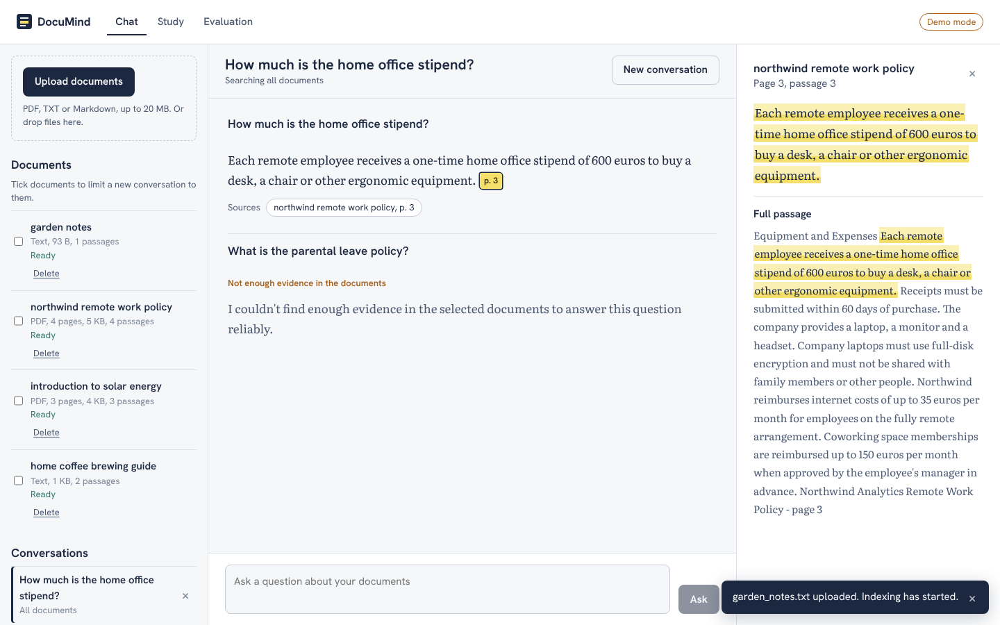
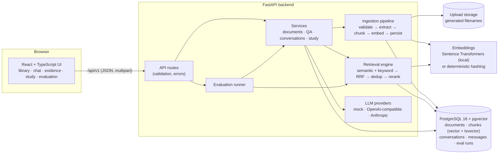
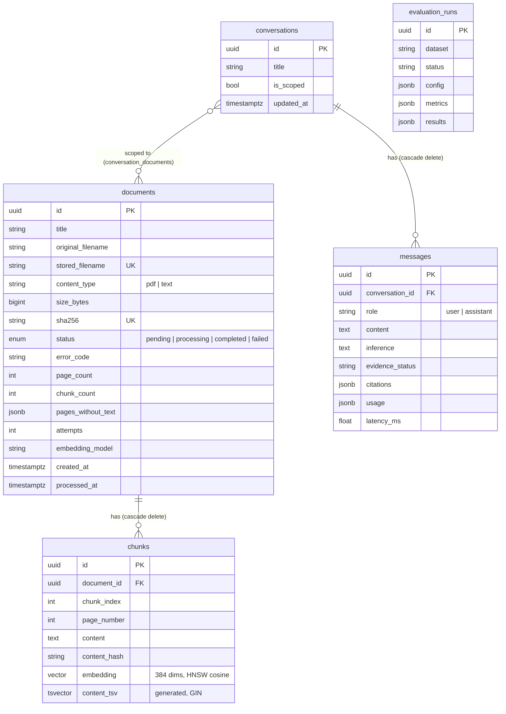
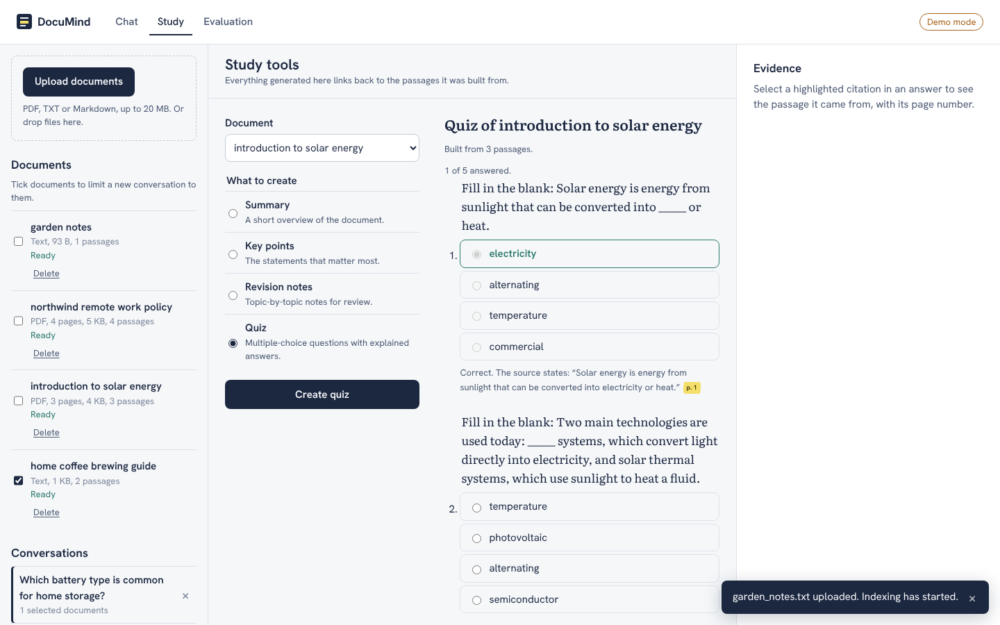
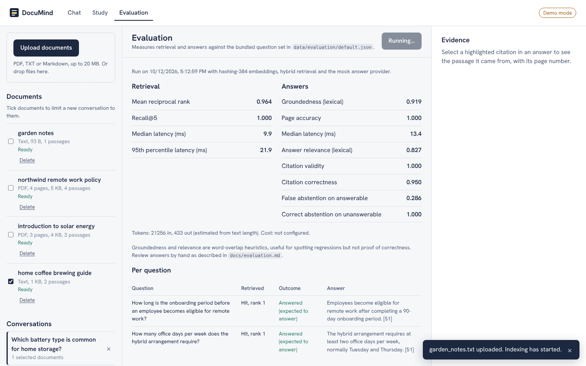

# DocuMind AI

An intelligent document assistant built on Retrieval-Augmented Generation (RAG). Upload PDFs or text files, ask questions in plain language, and get answers that cite the exact passage and page they came from. When the documents don't contain the answer, DocuMind says so instead of guessing.

This is an **educational portfolio project** designed as a single-user local application. It has not been security-audited or load-tested and is not production-ready (see [Security and limitations](#security-and-limitations)).



## Contents

- [Problem and intended users](#problem-and-intended-users)
- [Features](#features)
- [Architecture](#architecture)
- [Technology choices](#technology-choices)
- [Data pipeline](#data-pipeline)
- [RAG workflow](#rag-workflow)
- [Database schema](#database-schema)
- [Quick start with Docker](#quick-start-with-docker)
- [Local development setup](#local-development-setup)
- [Configuration](#configuration)
- [Demo walkthrough](#demo-walkthrough)
- [API](#api)
- [Testing](#testing)
- [Evaluation](#evaluation)
- [Security and limitations](#security-and-limitations)
- [Troubleshooting](#troubleshooting)
- [Screenshots](#screenshots)
- [Future improvements](#future-improvements)
- [License and acknowledgments](#license-and-acknowledgments)

## Problem and intended users

Language models answer confidently even when they are wrong, and long documents are slow to search by hand. DocuMind narrows the model to the content of your own documents and makes every answer checkable: each claim links to the passage and page that supports it.

It is aimed at students revising course readings, employees looking things up in policies or manuals, and anyone who needs to verify an answer against its source rather than trust it.

## Features

Everything listed here is implemented and covered by automated tests unless noted.

**Documents**
- Upload PDF, `.txt` and `.md` files (drag and drop or file picker), with validation by file content, not the filename or MIME type alone.
- Clear errors for empty, oversized, corrupt, password-protected, mislabelled and unsupported files.
- Duplicate detection by SHA-256 hash; re-uploading returns the existing document.
- Status tracking (pending, processing, completed, failed), error details, retry, and deletion that removes chunks, vectors and the stored file.
- Scanned PDFs without a text layer fail with an explicit "OCR required" message; pages without text in mixed PDFs are recorded and shown.

**Retrieval and answers**
- Semantic search with pgvector (HNSW cosine index), PostgreSQL full-text search (GIN index), and hybrid retrieval that fuses both with Reciprocal Rank Fusion.
- Near-duplicate passage removal and an optional lexical reranker behind a pluggable interface.
- Grounded answers with citations to real indexed passages: document title, page number and a supporting excerpt. Citation labels the model invents are removed.
- Explicit "insufficient evidence" responses; answers without a valid citation are flagged as unverified.
- The model's interpretation is shown separately from what the documents state.
- Prompt-injection safeguards and refusal of requests for system prompts or credentials.

**Conversations and study tools**
- Persisted conversations with follow-up questions, optionally scoped to selected documents. A scoped conversation never widens to other documents, even if its documents are deleted.
- Summaries, key points, revision notes and multiple-choice quizzes, each item linked to the passage it was built from. Items without a valid source are discarded and counted.

**Evaluation**
- A reproducible question set, a CLI script and an evaluation page: Recall@K, MRR, citation validity and correctness, page accuracy, groundedness, answer relevance, abstention rates, latency and token usage.

**Interface**
- React + TypeScript app with a document library, chat, evidence panel, study tools and evaluation view; responsive down to phone width, keyboard accessible, light and dark themes.
- **Demo mode** works with no API key (see [LLM providers](#llm-providers)).

## Architecture



The backend is a single FastAPI service with separate layers: `api` (routes), `services` (business logic), `ingestion`, `retrieval`, `llm` (providers and prompts), `evaluation`, `db` and `models`. Ingestion runs as a FastAPI background task after upload; there is no separate worker or message queue. More detail is in [docs/architecture.md](docs/architecture.md).

## Technology choices

| Layer | Choice | Why |
|---|---|---|
| API | FastAPI, Pydantic v2 | Typed validation and automatic OpenAPI docs. |
| Database | PostgreSQL 16 + pgvector | One database for metadata, vectors and full-text search, so hybrid retrieval is a pair of SQL queries and deletion cascades in one transaction. |
| ORM / migrations | SQLAlchemy 2, Alembic | Parameterized queries and versioned schema. |
| PDF extraction | PyMuPDF | Fast, page-aware text extraction and encryption detection. |
| Embeddings | Sentence Transformers `all-MiniLM-L6-v2` | Small (384-dim), runs on CPU, no API cost. |
| LLM | Provider interface over httpx | Swap OpenAI-compatible APIs (including local Ollama) or Anthropic by configuration; a deterministic mock powers demo mode and tests. |
| Frontend | React 19, TypeScript, Vite | Typed client, fast builds. Fonts are bundled locally (no third-party requests). |
| Quality | pytest, Ruff, ESLint, GitHub Actions | |

Apache Airflow was considered and left out: ingestion is event-driven (one upload, one job) and incremental batch processing is covered by `IngestionPipeline.run_pending()`. A scheduler would add operational weight without a real use case here.

## Data pipeline

Ingestion (`backend/app/ingestion/pipeline.py`) is a sequence of explicit, individually testable stages:

1. **Validate** (`validation.py`): size limit, extension allowlist, content checks (PDF magic bytes, PyMuPDF open, encryption, page limit; UTF-8 and control-character ratio for text), SHA-256 hash, filename sanitization.
2. **Store**: bytes are written atomically under a server-generated name (`<uuid>.pdf|txt`).
3. **Extract** (`extraction.py`): text per page, so every chunk keeps its page number.
4. **Clean**: Unicode normalization, ligatures, soft hyphens, de-hyphenation across line breaks, heading separation, whitespace.
5. **Check coverage**: if no page has usable text, fail with `ocr_required`; otherwise record pages without text.
6. **Chunk** (`chunking.py`): overlapping chunks (default 1,000 characters, 150 overlap) that prefer paragraph and sentence boundaries and never cross pages. Exact duplicate chunks are skipped.
7. **Embed** (`embeddings.py`): batched (default 32 per batch), dimension-checked.
8. **Persist**: old chunks are deleted and new ones inserted in **one transaction**, then the document is marked completed with counts and timestamps.

Properties:
- **Idempotent**: re-running ingestion replaces chunks rather than duplicating them, and a completed document with the same embedding model is skipped unless forced.
- **Retryable**: failures record `error_code` and `error_message`; `POST /documents/{id}/retry` re-queues the document. Stale `processing` claims (older than 30 minutes) can be reclaimed.
- **Incremental**: uploading one document processes only that document; `run_pending()` processes only pending (optionally failed) documents.
- **Constrained**: unique `(document_id, chunk_index)`, unique file hash, check constraints on sizes, spans, roles and content types, and indexes for status, time and both search methods.

## RAG workflow

`backend/app/services/qa.py`:

1. **Validate and normalize** the question (length limit, whitespace).
2. **Refuse** requests for system prompts, credentials or configuration before any retrieval.
3. **Resolve scope**: selected documents must exist; only completed documents are searched.
4. **Expand follow-ups**: short or pronoun-based follow-up questions are combined with the previous user question for retrieval.
5. **Retrieve** with hybrid search (top 6 by default, from 20 candidates per method), dedupe and rerank.
6. **Evidence gate**: if no passage covers enough of the question, return "insufficient evidence" without calling the LLM.
7. **Build the prompt**: passages are wrapped in `<source id="S1" title=… page=…>` blocks, delimiter-like text inside documents is neutralized, suspicious passages are flagged, and the system prompt states that sources are data, not instructions.
8. **Generate** with the configured provider.
9. **Validate the output**: parse `ANSWER:` and `INFERENCE:` sections, drop citation labels that don't correspond to a supplied passage, redact the configured API key, and attach each citation's title, page and best-matching excerpt from the real chunk.
10. **Classify**: `supported` (at least one valid citation), `unverified` (an answer with no valid citation), `insufficient_evidence`, or `refused`.

### LLM providers

| `DOCUMIND_LLM_PROVIDER` | What it does |
|---|---|
| `mock` (default) | **Demo mode.** No API key, fully offline and deterministic. It does not generate prose: it selects the retrieved sentences that best cover the question (IDF-weighted term overlap), cites them, and abstains when coverage is too low. Study tools are built extractively. Useful for demos and tests, but it misses answers phrased differently from the text. |
| `openai` | Any OpenAI-compatible `/chat/completions` API: OpenAI, Groq, Together, or a local Ollama / llama.cpp server via `DOCUMIND_LLM_BASE_URL`. |
| `anthropic` | Anthropic Messages API. |

The automated tests exercise the remote providers against mocked HTTP responses only (both regular and streaming). The OpenAI-compatible provider has also been run against a live local model (`llama3.2:3b` through Ollama) for the [real-model evaluation](#evaluation) and a manual streaming check. The Anthropic provider has **not** been exercised against the live API.

For a local model through Ollama, use `DOCUMIND_LLM_PROVIDER=openai`, `DOCUMIND_LLM_BASE_URL=http://localhost:11434/v1` (Ollama needs no API key; the evaluation used the placeholder `ollama`), and raise `DOCUMIND_LLM_TIMEOUT_S` (300 worked for a 3B model on a laptop CPU).

## Database schema



The schema is created by the Alembic migration `backend/migrations/versions/0001_initial_schema.py`.

## Quick start with Docker

Requirements: Docker with Compose v2.

```bash
cp .env.example .env            # then set POSTGRES_PASSWORD (URL-safe characters only)
docker compose up --build -d
docker compose exec backend python /srv/documind/scripts/seed_demo.py   # optional sample documents
```

Windows PowerShell:

```powershell
Copy-Item .env.example .env     # then edit POSTGRES_PASSWORD in .env
docker compose up --build -d
docker compose exec backend python /srv/documind/scripts/seed_demo.py
```

Then open:
- App: http://localhost:8080
- API docs: http://localhost:8080/api/v1/docs (or http://localhost:8000/api/v1/docs directly)

The stack has three services: `db` (pgvector/pgvector:pg16, persistent `pgdata` volume), `backend` (runs migrations on start, then uvicorn) and `frontend` (nginx serving the built app and proxying `/api`). Health checks gate startup order: the backend waits for a healthy database, and the frontend for a healthy backend.

The first time a document is indexed, the backend downloads the `all-MiniLM-L6-v2` model (about 90 MB) into the `models` volume. For a smaller image without the ML stack, set `INSTALL_ML=false` and `DOCUMIND_EMBEDDING_PROVIDER=hashing` in `.env`.

Useful commands: `docker compose logs -f backend`, `docker compose down` (keeps data), `docker compose down -v` (deletes all data).

> **Verification note:** the Compose file was validated with `docker compose config`, and the image's file layout was reproduced and exercised outside Docker (migrations, seeding, evaluation). The images themselves could not be built in the development sandbox because Docker Hub was unreachable there; the CI workflow builds both images.

## Local development setup

Requirements: Python 3.12+, Node.js 20+ (22 recommended), PostgreSQL 16 with the pgvector extension.

### 1. Database

```bash
# As a PostgreSQL superuser:
psql -c "CREATE ROLE documind LOGIN PASSWORD 'change-me';"
psql -c "CREATE DATABASE documind OWNER documind;"
psql -d documind -c "CREATE EXTENSION IF NOT EXISTS vector;"
# For the database-backed tests:
psql -c "CREATE DATABASE documind_test OWNER documind;"
psql -d documind_test -c "CREATE EXTENSION IF NOT EXISTS vector;"
```

Or run only the database in Docker: `docker compose up -d db` (it listens inside the Compose network; add a `ports` mapping if you want to reach it from the host).

### 2. Backend

Linux / macOS / WSL:

```bash
cp .env.example .env                     # set DOCUMIND_DATABASE_URL
python3 -m venv .venv
source .venv/bin/activate
pip install -r backend/requirements-dev.txt
# Real embeddings (recommended; CPU-only torch avoids multi-GB CUDA wheels):
pip install torch --index-url https://download.pytorch.org/whl/cpu
pip install -r backend/requirements-ml.txt
# ...or skip those two lines and set DOCUMIND_EMBEDDING_PROVIDER=hashing in .env

cd backend
alembic upgrade head
uvicorn app.main:app --reload --port 8000
```

Windows PowerShell:

```powershell
Copy-Item .env.example .env              # set DOCUMIND_DATABASE_URL
py -3.12 -m venv .venv
.\.venv\Scripts\Activate.ps1
pip install -r backend\requirements-dev.txt
pip install torch --index-url https://download.pytorch.org/whl/cpu
pip install -r backend\requirements-ml.txt

Set-Location backend
alembic upgrade head
uvicorn app.main:app --reload --port 8000
```

### 3. Frontend

```bash
cd frontend
npm ci
npm run dev        # http://localhost:5173, proxies /api to http://localhost:8000
```

The same commands work in PowerShell. Override the proxy target with `VITE_API_PROXY_TARGET`, or point the built app at another API with `VITE_API_BASE_URL`.

### 4. Sample data

From the project root, with the virtual environment active:

```bash
python scripts/seed_demo.py              # loads and indexes data/sample_documents/
python scripts/seed_demo.py --reindex    # rebuild after changing chunking or embedding settings
```

A `Makefile` wraps the common commands (`make install`, `make migrate`, `make backend`, `make frontend`, `make seed`, `make test`, `make lint`, `make eval`, `make docker-up`).

## Configuration

All settings are environment variables prefixed with `DOCUMIND_`, read from the environment or a `.env` file at the project root. `.env.example` lists them with defaults.

| Variable | Required | Default | Notes |
|---|---|---|---|
| `POSTGRES_PASSWORD` | Docker only | none | Compose refuses to start without it. Use URL-safe characters. |
| `DOCUMIND_DATABASE_URL` | Local runs | local `documind` database | Compose builds this itself. |
| `DOCUMIND_LLM_PROVIDER` | No | `mock` | `mock`, `openai` or `anthropic`. |
| `DOCUMIND_LLM_API_KEY` | For hosted LLMs | empty | Never logged; redacted from model output. |
| `DOCUMIND_LLM_MODEL`, `DOCUMIND_LLM_BASE_URL` | No | `gpt-4o-mini`, OpenAI URL | Point the base URL at Ollama for a local model. |
| `DOCUMIND_LLM_TIMEOUT_S` | No | `60` | Raise for local models on CPU (e.g. `300`). |
| `DOCUMIND_EMBEDDING_PROVIDER` | No | `sentence-transformers` | `hashing` for offline use or tests. |
| `DOCUMIND_EMBEDDING_MODEL`, `DOCUMIND_EMBEDDING_DIM` | No | MiniLM, `384` | Changing the dimension requires a new migration. |
| `DOCUMIND_CHUNK_SIZE`, `DOCUMIND_CHUNK_OVERLAP` | No | `1000`, `150` | Re-index after changing. |
| `DOCUMIND_RETRIEVAL_MODE`, `DOCUMIND_RETRIEVAL_TOP_K`, `DOCUMIND_RERANKER` | No | `hybrid`, `6`, `lexical` | |
| `DOCUMIND_MAX_UPLOAD_MB`, `DOCUMIND_MAX_PDF_PAGES` | No | `20`, `500` | |
| `DOCUMIND_CORS_ORIGINS` | No | `http://localhost:5173` | Comma-separated list. |
| `DOCUMIND_LLM_COST_PER_1K_INPUT` / `_OUTPUT` | No | unset | Enables cost estimates in evaluation. |
| `DOCUMIND_LOG_FORMAT`, `DOCUMIND_LOG_LEVEL` | No | `json`, `INFO` | |

## Demo walkthrough

1. Start the app and run `seed_demo.py` (or upload your own files with **Upload documents**).
2. Wait until each document shows **Ready**.
3. In **Chat**, ask *"How much is the home office stipend?"* The answer carries a highlighted page mark; select it to open the passage in the evidence panel, then **Show full passage** to see it in context.
4. Ask *"What is the parental leave policy?"* DocuMind reports that the documents don't contain enough evidence.
5. Start a **New conversation**, tick only *home coffee brewing guide* in the library, and ask about solar batteries: the scoped conversation won't search the other documents.
6. In **Study**, pick a document and create a quiz; each explanation links to its source page.
7. In **Evaluation**, press **Run evaluation** to measure the system on the bundled question set.

Sample documents are original texts written for this project (CC0). "Northwind Analytics" is fictional.

## API

Interactive OpenAPI documentation is served at `/api/v1/docs` (Swagger UI) and `/api/v1/redoc`. A summary with examples is in [docs/api.md](docs/api.md).

| Method | Path | Purpose |
|---|---|---|
| GET | `/api/v1/health`, `/api/v1/ready` | Liveness; readiness (database, pgvector, migration revision) |
| POST | `/api/v1/documents` | Upload (201 new, 200 duplicate) |
| GET | `/api/v1/documents`, `/api/v1/documents/{id}` | List (paginated, status filter), details |
| GET | `/api/v1/documents/{id}/status` | Ingestion status |
| POST | `/api/v1/documents/{id}/retry` | Retry failed ingestion (`force=true` re-indexes) |
| DELETE | `/api/v1/documents/{id}` | Delete document, chunks and file |
| GET | `/api/v1/documents/{id}/chunks`, `/api/v1/chunks/{id}` | Indexed passages |
| POST | `/api/v1/search` | Retrieval only (hybrid, semantic or keyword) |
| POST | `/api/v1/ask` | Stateless grounded answer |
| POST/GET/DELETE | `/api/v1/conversations[/{id}]` | Conversation history |
| POST | `/api/v1/conversations/{id}/messages` | Ask within a conversation |
| POST | `/api/v1/documents/{id}/study` | Summary, key points, revision notes or quiz |
| POST/GET | `/api/v1/evaluation/runs[/{id}]` | Run and read evaluations |

Errors share one shape: `{"error": {"code": "...", "message": "...", "details": {}}}`. Unexpected errors return a generic message; stack traces are only logged.

## Testing

```bash
cd backend
pytest                    # all tests; database tests auto-skip if PostgreSQL is unreachable
pytest -m "not db"        # tests that need no database
```

Database tests use `DOCUMIND_TEST_DATABASE_URL` (default: a passwordless connection to a local `documind_test` database; set it if your database needs a password). They migrate it from scratch, then truncate tables between tests. All tests use the hashing embedder and the deterministic mock LLM; remote providers are tested against mocked HTTP.

**Last local run:** 132 tests passed, 0 failed, 0 skipped (78 unit tests plus 54 PostgreSQL 16 + pgvector 0.6 tests), on both Python 3.13 and a clean Python 3.12 install. Frontend: ESLint, `tsc -b` and `vite build` pass.

Coverage by area: validation and filename sanitization; extraction, page tracking and normalization; chunking and metadata; embedding interfaces and batching; persistence and constraints; duplicate uploads; ingestion failure, retry, OCR detection and missing files; incremental processing; semantic, keyword and hybrid retrieval; SQL-injection safety of keyword search; document scoping; citation validation and removal of invented citations; insufficient evidence; secret-request refusal; prompt-injection neutralization; conversations and follow-ups; study tools; API validation, status codes and error shape; deletion cascade; evaluation endpoints; metric calculations; configuration parsing; provider HTTP handling.

The frontend has no automated component tests. It was checked end to end in headless Chromium (upload, ask, citation and evidence panel, insufficient evidence, scoped conversation, quiz, evaluation, mobile width, dark mode) with no console errors; that script is not part of the repository.

## Evaluation

The dataset `data/evaluation/default.json` has 18 questions over the 3 sample documents: 14 answerable (each with the document, page, evidence phrases and a reference answer) and 4 that should be declined (3 out of scope, 1 prompt-injection attempt). Run it with:

```bash
python scripts/evaluate_rag.py               # stores the run in the database and writes JSON
python scripts/evaluate_rag.py --retrieval-only --no-store
```

Results are written to `data/evaluation/results/<dataset>_<timestamp>.json` and `<dataset>_latest.json`, and appear on the **Evaluation** page. Methodology, metric definitions and the manual review procedure are in [docs/evaluation.md](docs/evaluation.md).

### Measured results (demo configuration)

Measured on 2026-10-12 with the **hashing embedder** and the **mock (extractive) provider**, hybrid retrieval, lexical reranker, top-k 5. Raw output: [docs/evaluation-results-demo.json](docs/evaluation-results-demo.json).

| Retrieval (14 answerable) | Value | | Answers | Value |
|---|---|---|---|---|
| Recall@5 | 1.000 | | Answered (of 14 answerable) | 10 |
| MRR | 0.964 | | False abstention rate | 0.286 |
| Median latency | 9.9 ms | | Correct abstention (4 unanswerable) | 1.000 |
| | | | Citation validity | 1.000 |
| | | | Citation correctness | 0.950 |
| | | | Page accuracy | 1.000 |
| | | | Groundedness (lexical) | 0.919 |
| | | | Answer relevance (lexical) | 0.827 |

How to read these honestly:
- The dataset is tiny (3 short documents, 18 questions) and written by the same author as the system, so these numbers show the pipeline works; they are not a benchmark.
- With only 9 chunks in total, perfect Recall@5 is easy. Larger corpora will score lower.
- The demo provider's 4 false abstentions are vocabulary mismatches (e.g. "monthly reimbursement limit for internet costs" against "reimburses internet costs of up to 35 euros per month"). One answer cites a weakly related sentence first. The real-model run below answers all four.
- Groundedness and relevance are word-overlap heuristics, not judgments of correctness.

### Measured results (real models: all-MiniLM-L6-v2 + llama3.2:3b via Ollama, CPU)

Measured on 2026-11-02 with Sentence Transformers `all-MiniLM-L6-v2` embeddings and `llama3.2:3b` served by Ollama 0.40.11 through the OpenAI-compatible provider. Same dataset and retrieval settings as above (hybrid, lexical reranker, top-k 5). Raw output: [docs/evaluation-results-ollama.json](docs/evaluation-results-ollama.json).

Hardware: a laptop with an Intel Core i7-1255U (10 cores, 12 threads) and 32 GB RAM, Windows 11, **CPU only** (no GPU); torch 2.15.0+cpu, sentence-transformers 5.7.0.

| Retrieval (14 answerable) | Value | | Answers | Value |
|---|---|---|---|---|
| Recall@5 | 1.000 | | Answered (of 14 answerable) | 14 |
| MRR | 0.929 | | False abstention rate | 0.000 |
| Median latency | 42.2 ms | | Correct abstention (4 unanswerable) | 1.000 |
| p95 latency | 110.5 ms | | Citation validity | 1.000 |
| | | | Citation correctness | 1.000 |
| | | | Page accuracy | 1.000 |
| | | | Groundedness (lexical) | 0.872 |
| | | | Answer relevance (lexical) | 0.912 |
| | | | Answer latency, median / p95 | 26.6 s / 35.1 s |
| | | | Tokens in / out (reported by Ollama) | 18,861 / 618 |

The reported numbers come from the third run with this setup. The first two runs exposed output-format problems in the 3B model that were fixed in code (with regression tests) before the next run:

| Run | Citation validity | Correct abstention | What happened, and the fix |
|---|---|---|---|
| 1 | 0.000 | 0.750 | All 14 answers were correct in substance but carried no `[S1]` labels, so all were "unverified". One unanswerable question came back as `ANSWER: None` and counted as an answer. Fix: a concrete format example and a citation reminder in the prompt, parsing of label variants (`(S1)`, `[S1, S2]`, `[S1-S4]`), and placeholder answers treated as abstentions. |
| 2 | 1.000 | 0.500 | Citations fixed, but two unanswerable questions got prose refusals such as "The inventor of the first solar cell is not mentioned in the passages [S1].", and one was even classified as supported. Fix: an explicit prompt rule, and one-sentence "the passages don't mention X" answers classified as abstentions. Factual negatives such as "X does not contain Y [S2]." are still answers. |
| 3 | 1.000 | 1.000 | Reported above. |

Run 1 also reported a retrieval p95 of 31.4 s. That was the embedding model loading inside the first timed query; the evaluation now loads it before timing.

Comparing the two setups:
- **Better with real models:** all 14 answerable questions are answered (demo: 10). The LLM handles the paraphrased questions that made the extractive demo abstain; for example, the internet-costs question is answered "35 euros per month [S1]". Citation correctness rises to 1.000 (demo: 0.950) and lexical answer relevance to 0.912 (demo: 0.827).
- **The same:** Recall@5 is 1.000 in both, and both decline all 4 unanswerable questions. Only 2 of those 4 reach the model, though: one is stopped by the evidence gate and the prompt-injection attempt is refused before retrieval. So the model's own abstention behaviour rests on just 2 questions.
- **Worse with real models:** MRR is 0.929 (demo: 0.964). Both setups rank the relevant chunk second for one solar question, and MiniLM also does so for the French-press question. Lexical groundedness is 0.872 (demo: 0.919), which is expected since the LLM rephrases instead of copying sentences; this metric penalizes paraphrase and does not show the answers are less faithful. Retrieval takes about 42 ms instead of 10 ms because the query is embedded with MiniLM on the CPU.
- **Latency is the big cost:** a median of 26.6 s and a p95 of 35.1 s per question on this CPU, against milliseconds for the demo. Answers are short (618 output tokens over 16 model calls), and the time goes mostly to processing the ~1,200-token prompt. In a manual streaming check, a 23-token answer streamed in about 2 s once the first token arrived, but the first token took about 44 s (including reloading the model after it had been idle). Streaming therefore helps much less on a CPU than with a GPU or a hosted API.

Caveats: the prompt and parser fixes were made while looking at this same 18-question set, so these numbers are optimistic. Latency varies between runs on a laptop (the median was 32.9 s in run 2), and a 3B model is far from the state of the art.

## Security and limitations

Summary (full details in [docs/security.md](docs/security.md)):

- **Single-user local demo. There is no authentication or authorization.** Anyone who can reach the API can read and delete every document. Ports are bound to `127.0.0.1` in Compose; don't expose it to a network without adding auth.
- Secrets come only from environment variables; the API key is a `SecretStr`, never logged, and redacted from model output and logs.
- Uploads are validated by content, size-limited and stored under generated names; client filenames never become paths.
- All SQL uses bound parameters; keyword queries are reduced to alphanumeric terms.
- Errors return safe messages; stack traces go to logs only. Logs record IDs and counts, not document contents.
- Prompt-injection defenses reduce risk but **do not eliminate it**: a determined document can still influence a model's answer. The pattern lists are heuristics with false positives and negatives.
- Ingestion runs in-process: a crash mid-ingestion leaves a document in `processing` until the 30-minute stale window passes, after which retry works.
- No OCR; scanned pages are detected and reported, not read.

## Troubleshooting

See [docs/troubleshooting.md](docs/troubleshooting.md) for more. Common issues:

| Symptom | Fix |
|---|---|
| UI banner "Can't reach the DocuMind API" | Start the backend; in dev, check the Vite proxy target (`VITE_API_PROXY_TARGET`). |
| `/ready` returns `not_migrated` | Run `alembic upgrade head` from `backend/`. |
| `type "vector" does not exist` | Install pgvector and run `CREATE EXTENSION vector;` as a superuser. |
| Document fails with `ocr_required` | The PDF has no text layer. Run OCR (e.g. `ocrmypdf in.pdf out.pdf`) and upload the result. |
| `sentence-transformers is not installed` | Install `backend/requirements-ml.txt`, or set `DOCUMIND_EMBEDDING_PROVIDER=hashing`. |
| Model download fails | The machine can't reach huggingface.co. Pre-download the model, or use `hashing`. |
| Database tests are skipped | Set `DOCUMIND_TEST_DATABASE_URL` to a database with pgvector. |
| Answers with a local model fail with `llm_provider_error` after about a minute | CPU inference is slow: raise `DOCUMIND_LLM_TIMEOUT_S` (e.g. `300`). |
| `vite build` on Windows: "Cannot find native binding" (`@rolldown/binding-win32-x64-msvc`) | The lockfile was generated on Linux, so `npm ci` skips the Windows binding. Use Node 22, then `npm install --no-save @rolldown/binding-win32-x64-msvc@<version of node_modules/rolldown>`. |
| Answers always say "insufficient evidence" in demo mode | The extractive demo matches words; rephrase using the document's terms, or configure a real LLM. |

## Screenshots

| | |
|---|---|
|  |  |


The screenshots were captured from the running application in demo mode. 

## Future improvements

- Authentication and per-user document ownership.
- A durable job queue (for example RQ or Celery) instead of in-process background tasks.
- OCR for scanned pages (OCRmyPDF or Tesseract).
- A cross-encoder reranker behind the existing `Reranker` interface.
- Streaming answers, and evaluation runs with real LLMs and embeddings on a larger, independently written dataset.
- Frontend component tests (Vitest + Testing Library) and an end-to-end suite in CI.
- More formats (DOCX, HTML) and table-aware PDF extraction.

