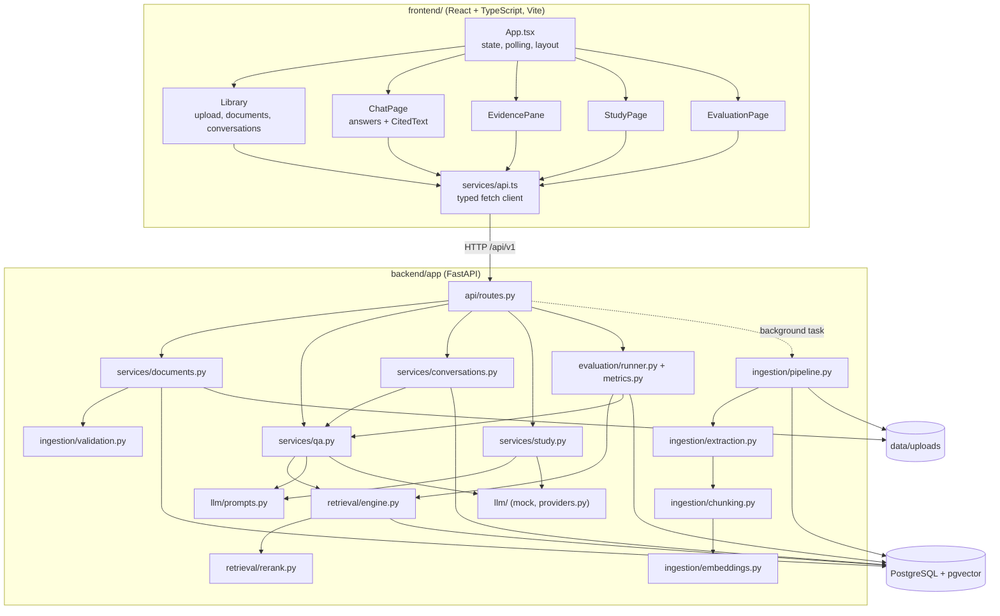
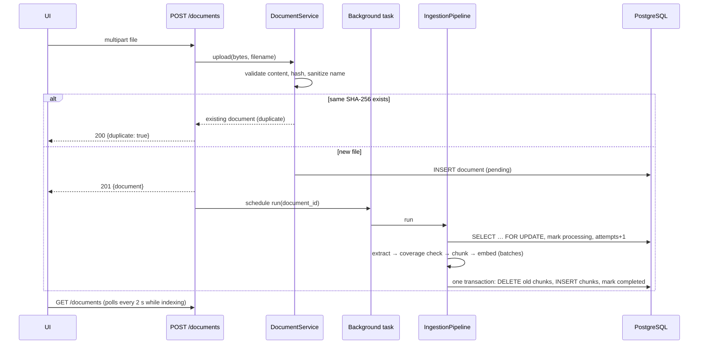
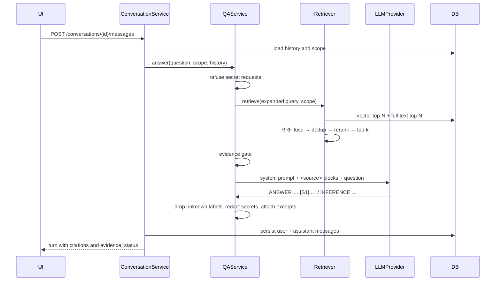

# Architecture

DocuMind AI is a modular monolith: one FastAPI service, one PostgreSQL database, and a static React frontend. It deliberately avoids microservices, message brokers and agent frameworks; each would add moving parts without solving a problem this application has.

## Components

| Layer | Responsibility |
|---|---|
| `api/` | HTTP concerns only: request parsing, status codes, response models. Routes call one service method. |
| `services/` | Business rules: duplicate handling, scoping, the RAG flow, citation validation, conversation persistence, study-item grounding. |
| `ingestion/` | Pure, testable stages plus `IngestionPipeline`, which orchestrates them and owns status transitions. |
| `retrieval/` | Semantic, keyword and hybrid search, deduplication, reranking. No LLM knowledge. |
| `llm/` | The `LLMProvider` protocol, implementations, prompt templates and output parsing. |
| `evaluation/` | Metric functions (pure) and the dataset runner. |
| `core/` | Settings, structured logging, error types and handlers, small text helpers. |
| `db/`, `models/` | Engine/session management and ORM models; the schema itself is owned by Alembic migrations. |

## Request flows

### Upload and ingestion

### Question answering

## Key design decisions

**One database for everything.** Vectors, full-text indexes and relational metadata live in PostgreSQL. Hybrid retrieval is two indexed queries, deletion cascades atomically, and there is no second store to keep in sync. The trade-off is that pgvector's HNSW index is less tunable than a dedicated vector database; for a single-user corpus that is irrelevant.

**Chunks never cross pages.** Each chunk maps to exactly one page, so a citation's page number is a fact, not an estimate. The cost is that a sentence spanning a page break is split.

**Reciprocal Rank Fusion for hybrid search.** Cosine similarities and `ts_rank_cd` scores aren't on comparable scales; RRF uses only ranks (`1 / (60 + rank)` per list), which needs no score normalization or tuning.

**An evidence gate before the LLM.** If no retrieved passage covers enough of the question's terms (or, with a semantic embedding model, if the best similarity is below `DOCUMIND_MIN_SEMANTIC_SCORE`), the service answers "insufficient evidence" without a model call. This saves cost and avoids giving a model irrelevant context to improvise from. It can cause false abstentions on paraphrased questions; the evaluation tracks that rate.

**Citations are validated after generation.** The model sees passages labelled `S1…Sn`. Any label it emits that wasn't supplied is stripped, and each surviving citation is rebuilt from the database row (title, page, chunk), so a citation can never point to something that wasn't retrieved.

**Background tasks instead of a queue.** FastAPI background tasks keep deployment to one process. The cost is durability: a crash mid-ingestion leaves the document in `processing`. The pipeline treats claims older than 30 minutes as stale and allows a retry. A real queue is listed under future improvements.

**A deterministic mock provider.** Tests and demo mode need answers without a network or key. The mock is extractive on purpose: it can only return text that exists in retrieved passages, so demo mode can't fabricate content.

**Pluggable embeddings.** `SentenceTransformerEmbedder` is the default. `HashingEmbedder` (signed feature hashing over stemmed unigrams and bigrams) makes the whole pipeline runnable offline and deterministic in CI. It is lexical, not semantic, and should not be used to judge retrieval quality.

## Deployment model

Single-user, local. Docker Compose runs `db`, `backend` and `frontend`; nginx serves the built frontend and proxies `/api` to the backend, so the browser sees one origin. Host ports bind to `127.0.0.1`. There is no authentication, so the application must not be exposed to an untrusted network as-is.
